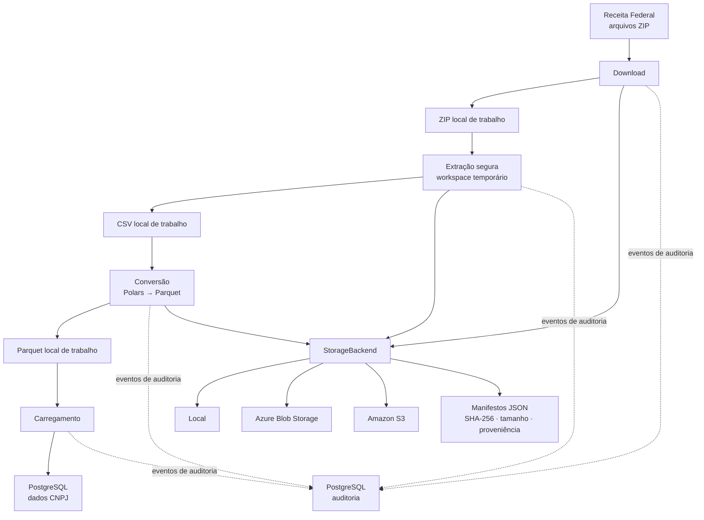

# CNPJ ETL — Dados Abertos da Receita Federal

Pipeline para download, extração, conversão e carregamento dos dados públicos do Cadastro Nacional da Pessoa Jurídica (CNPJ), disponibilizados pela Receita Federal do Brasil.

O projeto transforma os arquivos oficiais em tabelas PostgreSQL e mantém artefatos intermediários recuperáveis. A persistência é configurável: filesystem local, Azure Blob Storage ou Amazon S3.

## O que o pipeline faz

1. **Descobre e baixa** os arquivos do período selecionado, com download em streaming e retry.
2. **Extrai** os CSVs em workspaces isolados e valida os caminhos dos membros dos ZIPs.
3. **Converte** CSV para Parquet usando Polars.
4. **Carrega** os dados no PostgreSQL com operações em lote e suporte a carregamento incremental.
5. **Audita** a execução e registra metadados dos artefatos persistidos.

Os períodos podem ser informados por ano/mês ou descobertos a partir das publicações disponíveis na fonte.

## Arquitetura



### Persistência não é filesystem montado

O object storage é usado para persistência durável e recuperação de artefatos, não como filesystem montado. As etapas que dependem de caminhos locais — como extração, Polars e loaders — continuam trabalhando com arquivos no workspace local.

O contrato `StorageBackend` possui três implementações:

| Provider | Configuração | Autenticação |
|---|---|---|
| `local` | `STORAGE_ROOT_PATH` | Permissões do filesystem |
| `azure` | URL da conta e container existente | Azure `DefaultAzureCredential` |
| `s3` | Bucket existente e região opcional | Boto3 credential provider chain |

`local` é o provider padrão. Os SDKs de Azure e AWS são opcionais e carregados somente quando o provider correspondente é selecionado.

### Artefatos e manifestos

Os objetos usam chaves relativas POSIX e prefixos por período. A organização inclui:

- `raw/zip/{ano}/{mês}/` — arquivos ZIP baixados.
- `raw/extracted/{ano}/{mês}/` — arquivos extraídos, identificados pela origem.
- `processed/parquet/{ano}/{mês}/` — arquivos Parquet.
- `metadata/{object_key}.json` — manifesto do artefato.

Os manifestos registram versão do schema, estágio, período, chave do objeto, origem quando aplicável, tamanho em bytes, SHA-256 e timestamp UTC. Regravações da mesma chave de manifesto são idempotentes.

O workspace local e o storage durável têm ciclos de vida distintos. `ETL_DELETE_FILES` controla a limpeza dos arquivos locais de processamento; não é uma política de retenção dos objetos remotos.

## Fonte e modelo de dados

- **Dados:** [Cadastro Nacional da Pessoa Jurídica — Portal de Dados Abertos](https://dados.gov.br/dados/conjuntos-dados/cadastro-nacional-da-pessoa-juridica---cnpj)
- **Layout:** [Metadados CNPJ — Receita Federal](https://www.gov.br/receitafederal/dados/cnpj-metadados.pdf)
- **Diagrama:** [Modelo entidade-relacionamento](images/Dados_RFB_ERD.png)

As tabelas de negócio incluem `empresa`, `estabelecimento`, `socios` e `simples`. O projeto também carrega tabelas de referência, como CNAE, natureza jurídica, municípios e países. A composição e o volume dos arquivos podem variar entre publicações; consulte o layout oficial para o significado e os domínios dos campos.

## Requisitos

- Python **3.11 ou superior**.
- PostgreSQL **14 ou superior**.
- [uv](https://docs.astral.sh/uv/) para sincronizar as dependências e executar os comandos.
- Espaço em disco suficiente para ZIPs baixados, CSVs extraídos, Parquet e workspaces locais. O uso de Azure ou S3 não elimina a necessidade de staging local.

A memória e o espaço necessários dependem do período, dos arquivos selecionados, da configuração dos batches e da concorrência. Não trate números de uma execução específica como requisito universal.

## Quickstart

### 1. Clone o projeto e a dependência local

O `pyproject.toml` configura `sqldim` como dependência editável em `../sqldim`. Portanto, os dois repositórios precisam estar lado a lado:

```bash
git clone https://github.com/brunolnetto/scrapper-rf-cnpj.git
cd scrapper-rf-cnpj

git clone https://github.com/brunolnetto/sqldim.git ../sqldim
```

> Se você já possui um checkout de `sqldim`, confirme que ele está no caminho `../sqldim` e em uma versão compatível com a dependência declarada pelo projeto.

### 2. Instale as dependências

```bash
uv sync --locked
```

Esse comando cria/atualiza o ambiente virtual a partir do `pyproject.toml` e do `uv.lock`. Não é necessário instalar um `requirements.txt`: o projeto usa o fluxo de dependências do uv.

### 3. Prepare os bancos PostgreSQL

Crie dois bancos: um para os dados do CNPJ e outro para auditoria. Exemplo usando um usuário dedicado:

```sql
CREATE ROLE cnpj_etl LOGIN PASSWORD 'substitua-esta-senha';
CREATE DATABASE dadosrfb OWNER cnpj_etl;
CREATE DATABASE dadosrfb_analysis OWNER cnpj_etl;
```

Execute o SQL com um administrador PostgreSQL. O pipeline cria as tabelas mapeadas quando inicializa cada banco; o usuário de execução precisa ter as permissões necessárias para isso.

### 4. Configure o ambiente

```bash
cp .env.template .env
```

Edite o `.env` com as credenciais e caminhos do seu ambiente. Configuração mínima de referência:

```env
ENVIRONMENT=development

POSTGRES_HOST=localhost
POSTGRES_PORT=5432
POSTGRES_USER=cnpj_etl
POSTGRES_PASSWORD=sua_senha
POSTGRES_DBNAME=dadosrfb

AUDIT_DB_HOST=localhost
AUDIT_DB_PORT=5432
AUDIT_DB_USER=cnpj_etl
AUDIT_DB_PASSWORD=sua_senha
AUDIT_DB_NAME=dadosrfb_analysis

DOWNLOAD_PATH=data/DOWNLOADED_FILES
EXTRACTION_PATH=data/EXTRACTED_FILES
CONVERSION_PATH=data/CONVERTED_FILES

STORAGE_PROVIDER=local
STORAGE_ROOT_PATH=data/objects
```

O arquivo [.env.template](.env.template) é a referência prática para as variáveis do ambiente; os nomes efetivamente lidos estão mapeados em `src/setup/config/loader.py`.

**Importante — desenvolvimento versus processamento integral:** `ENVIRONMENT=development` ativa filtros de desenvolvimento automaticamente. No template atual, isso limita o tamanho dos arquivos, a quantidade de arquivos por tabela/ZIP e a fração de linhas processadas. Para desativar esses filtros e processar os arquivos completos, configure:

```env
ENVIRONMENT=production
```

Embora `ETL_DEV_ENABLED` apareça no `.env.template` atual, o loader não a utiliza para essa decisão; a fonte de verdade é `ENVIRONMENT`.

Não versione o arquivo `.env` nem credenciais. Para a autenticação de download da fonte, `RF_DOWNLOAD_TOKEN` é opcional e deve ser fornecido por variável de ambiente ou secret manager.

### 5. Execute o pipeline

Sem flags de etapa, o CLI executa o fluxo completo para o período mais recente que conseguir descobrir:

```bash
# Período mais recente disponível
uv run python -m src.main

# Período específico
uv run python -m src.main --year 2024 --month 12

# Seleção explícita de etapas
uv run python -m src.main --download
uv run python -m src.main --convert
uv run python -m src.main --load
uv run python -m src.main --download --convert --load
```

As etapas podem ser combinadas. `--convert` trabalha sobre CSVs já disponíveis no workspace; `--load` utiliza Parquet local ou recuperado do storage configurado.

**Atenção:** `--full-refresh` e `--clear-tables` alteram dados existentes no banco. Use-os somente quando compreender o impacto:

```bash
# Limpeza completa das tabelas antes do carregamento
uv run python -m src.main --year 2024 --month 12 --full-refresh

# Limpeza de tabelas específicas
uv run python -m src.main --clear-tables "empresa,estabelecimento"
```

O repositório também oferece atalhos no [justfile](justfile). Consulte `just --list` para ver as receitas disponíveis. Os comandos `just` pressupõem que `just` esteja instalado e que o Python do ambiente virtual esteja ativo no shell.

## Configurar Azure Blob Storage ou Amazon S3

Instale o extra correspondente:

```bash
# Azure
uv sync --locked --extra azure

# Amazon S3
uv sync --locked --extra s3

# Ambos
uv sync --locked --extra cloud
```

### Azure Blob Storage

Configure um container previamente criado:

```env
STORAGE_PROVIDER=azure
AZURE_STORAGE_ACCOUNT_URL=https://<conta>.blob.core.windows.net
AZURE_STORAGE_CONTAINER=<container>
AZURE_STORAGE_MAX_CONCURRENCY=4
```

A autenticação usa `DefaultAzureCredential`. Em desenvolvimento, disponibilize uma identidade reconhecida pela cadeia de credenciais do Azure; em execução hospedada, prefira managed/workload identity. A identidade precisa de permissões de leitura, escrita, listagem e exclusão de blobs compatíveis com as operações utilizadas.

### Amazon S3

Configure um bucket previamente criado:

```env
STORAGE_PROVIDER=s3
AWS_S3_BUCKET=<bucket>
AWS_REGION=<região>
AWS_S3_ENDPOINT_URL=
AWS_S3_MAX_CONCURRENCY=4
AWS_S3_MULTIPART_THRESHOLD_MB=64
```

As credenciais são resolvidas pela cadeia padrão do boto3, que pode utilizar perfil local, SSO, web identity ou role do ambiente de execução. O principal precisa das permissões de listagem do bucket e leitura, escrita e exclusão dos objetos; uploads multipart também exigem as permissões correspondentes.

O projeto não cria nem remove containers ou buckets. Provisione os recursos e conceda as permissões antes de selecionar o provider. Não coloque access keys, account keys ou SAS tokens no repositório.

## Configuração operacional

Alguns parâmetros usados com frequência:

| Variável | Finalidade |
|---|---|
| `ENVIRONMENT` | `development` ativa filtros; `production` desativa os filtros de desenvolvimento |
| `ETL_CONVERSION_CHUNK_SIZE` | Linhas por batch de conversão |
| `ETL_CONVERSION_MEMORY_LIMIT_MB` | Limite de memória configurado para conversão |
| `ETL_CONVERSION_WORKERS` | Workers de conversão |
| `ETL_LOADING_BATCH_SIZE` | Tamanho do batch de carregamento |
| `ETL_LOADING_WORKERS` | Workers de carregamento |
| `ETL_POOL_SIZE` | Limite consolidado do pool de conexões |
| `ETL_DOWNLOAD_WORKERS` | Workers de download |
| `ETL_DOWNLOAD_CHUNK_SIZE_MB` | Tamanho de chunk do download |
| `ETL_MAX_RETRIES` / `ETL_TIMEOUT_SECONDS` | Retry e timeout das operações |
| `ETL_DELETE_FILES` | Limpeza de arquivos locais após processamento |
| `ETL_USE_DUCKDB` | Habilita o caminho de carregamento via DuckDB |
| `STORAGE_PROVIDER` | Backend durável: `local`, `azure` ou `s3` |

Os valores default e os limites de validação pertencem aos modelos e ao loader. Consulte [.env.template](.env.template) antes de introduzir novas variáveis ou copiar configurações antigas.

## Testes e qualidade

Instale também as dependências de desenvolvimento (o grupo `dev` é sincronizado pelo fluxo padrão do projeto) e execute:

```bash
# Suíte de testes
uv run --locked pytest tests -q

# Testes do storage
uv run --locked pytest tests/core/storage -v

# Lint focado nos adapters e seus testes
uvx ruff check src/core/storage tests/core/storage
```

A suíte pode ignorar testes que dependam de fixtures locais externas não disponíveis no ambiente. Verifique a saída do pytest para distinguir skips esperados de falhas.

## Benchmarks

Os scripts em [benchmarks/](benchmarks/) permitem executar comparações de conversão e carregamento. Resultados dependem do dataset, hardware, configuração e estado do banco; publique números de throughput ou memória acompanhados dessas condições, em vez de tratá-los como garantias do pipeline.

## Estrutura do repositório

```text
scrapper-rf-cnpj/
├── src/
│   ├── core/
│   │   ├── services/
│   │   │   ├── analytics/
│   │   │   ├── audit/
│   │   │   ├── conversion/
│   │   │   ├── discovery/
│   │   │   ├── download/
│   │   │   ├── loading/
│   │   │   ├── memory/
│   │   │   ├── notifications/
│   │   │   └── observability/
│   │   ├── storage/
│   │   │   ├── azure_blob.py
│   │   │   ├── base.py
│   │   │   ├── factory.py
│   │   │   ├── local_backend.py
│   │   │   ├── manifest.py
│   │   │   └── s3.py
│   │   ├── orchestrator.py
│   │   ├── pipeline.py
│   │   ├── strategies.py
│   │   └── transforms.py
│   ├── database/
│   │   ├── models/
│   │   ├── engine.py
│   │   ├── schemas.py
│   │   └── service.py
│   ├── setup/
│   │   └── config/
│   └── main.py
├── benchmarks/
├── docs/
├── images/
├── scripts/
├── tests/
├── .env.template
├── justfile
├── pyproject.toml
└── uv.lock
```

## Troubleshooting

- **Falha ao instalar `sqldim`:** confirme que o repositório `sqldim` está em `../sqldim`, conforme a configuração de dependência local do `pyproject.toml`.
- **O processamento parece incompleto:** confira `ENVIRONMENT`. Em `development`, os filtros de amostragem estão ativos.
- **Falha de conexão PostgreSQL:** confira host, porta, usuário, senha, nomes dos dois bancos e permissões de criação de tabelas.
- **Sem espaço em disco:** considere ZIPs, CSVs extraídos, Parquet e workspaces simultâneos; storage remoto não substitui o staging local.
- **Falha de autenticação cloud:** verifique a identidade selecionada pela cadeia do SDK e as permissões do bucket/container.
- **Arquivo ZIP rejeitado:** confira a integridade do download e os caminhos dos membros do arquivo; entradas que escapariam do diretório de extração são rejeitadas.

Logs são estruturados e gerados pelo sistema de logging do projeto. Consulte a configuração local de logging para o destino e nível ativos.

## Contribuição

1. Abra uma issue descrevendo o problema ou a mudança.
2. Crie uma branch específica para a alteração.
3. Adicione ou atualize testes quando houver mudança de comportamento.
4. Execute a suíte pertinente e o lint aplicável.
5. Abra um Pull Request com contexto, decisões e evidências de validação.

## Licença

Distribuído sob a licença MIT. Consulte [LICENSE](LICENSE).

## Contato

Abra uma [issue no GitHub](https://github.com/brunolnetto/scrapper-rf-cnpj/issues) para dúvidas, bugs ou propostas.
